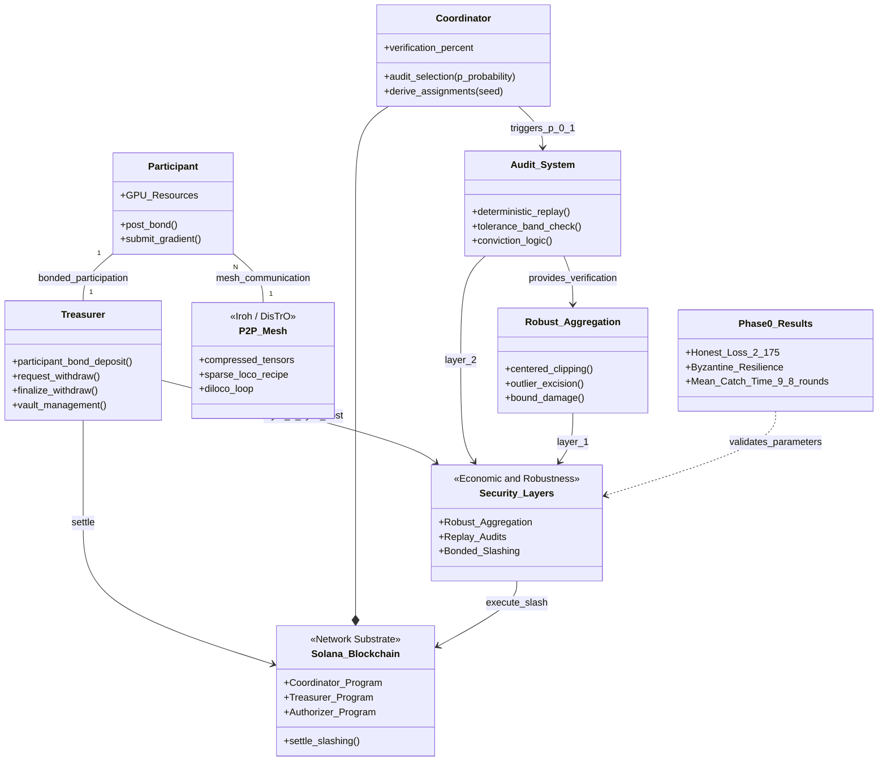

<p align="center">
    
</p>

<h1 align="center">Leviathan</h1>

<p align="center"><b>Trustless training for the People's model.</b></p>

Frontier AI is produced inside five balance sheets. The mathematics of training over the open internet is already solved and shipping; what remains unsolved is trust. Nobody has made it safe to accept a gradient from a stranger and pay them for it.

Leviathan is a Solana-coordinated training network where anyone with a GPU joins by posting a bond, earns Proof of Gradient for contributions that survive verification, and loses the bond if they lie. The chain carries commitments, audits and money. The mesh carries compressed tensors. The model belongs to the network that trained it.

Hobbes drew Leviathan as a giant composed of thousands of individuals. This one is composed of thousands of GPUs.

<p align="center">
    
</p>

> This repository is `leviathan-net`, the network substrate: a fork of [PsycheFoundation/nousnet](https://github.com/PsycheFoundation/nousnet) (Apache-2.0) that carries the layer upstream designed but left unimplemented. The vision, whitepaper, simulation and phase plan live in [wienerlabs/leviathan](https://github.com/wienerlabs/leviathan).

## The open slot

Every live decentralized-training network picked one column. Nobody picked both.

| | Verification guarantees | Live economics (bonds, slashing) |
|---|---|---|
| Bittensor training subnets | scoring gates, admitted gaps | emissions only, no bonds |
| Nous Psyche | witness liveness, verifier is a `todo!()` | no stake, dead slash code, whitelist |
| Gensyn Verde | strong, FP32 single-GPU determinism | pre-mainnet |
| OVIG | tolerance-band replay audits | a paper, not a network |
| **Leviathan** | **OVIG-style replay audits** | **bonds sized (1-p)/p, live slashing** |

The combination of bonded contributions, random replay audits and slashing is not run by anyone for live LLM training today. That is the entire moat, and every piece is individually proven in public work from 2024 to 2026.

## Security model

Three layers, each covering the others' gap:

1. **Robust aggregation bounds damage.** Centered clipping with far-outlier excision caps any contribution's influence radius in the round it happens. Re-validated on real transformer gradients: a 5/16 sign-flip coalition drives naive mean to divergence while clip plus excision holds the honest baseline and admits 3% of malicious contributions.
2. **Replay audits price lying.** Each contribution is audited with probability p. A contribution replayable from `(checkpoint, seed, data)` turns a mismatch beyond the calibrated tolerance band into a binary fraud proof. Under DisTrO that holds for a run's first step only: after it, each node's result also depends on error feedback it accumulates privately (#48). On the ALIE run at p = 0.1, all five stealth cheaters were caught at a mean of 9.8 rounds against the 1/p = 10 expectation.
3. **Bonds make sybil a cost.** Break-even bond = reward x (1-p)/p. A slashed identity re-enters only by posting a fresh bond, and slashed stake funds the verifiers hunting it. Security is self-funding under attack.

This is economic security with published parameters, never a cryptographic overclaim.

## Architecture



## What lives here

This fork carries the layer upstream left as dead code, wired to the reward engine and covered by the in-process `memnet` test harness (no validator required).

| Component | State |
|---|---|
| Bonded participation (`solana-treasurer`) | `participant_bond_deposit`, `request_withdraw`, `finalize_withdraw` with a challenge window; settlement forfeits slashed collateral into the run vault, and a withdrawal is held while the participant trains in an epoch not yet charged or while its own conviction is inside its challenge window or appeal; ejections only land where the epoch's charge is certain, and a conviction that can no longer land is charged at the bond on withdrawal, so a bond cannot leave before what it owes reaches it (#36) |
| Audit lottery (`shared/coordinator`, `solana-coordinator`) | `audit_selection` derives verifier-to-target assignments from the round seed, deterministic and replayable; audit pressure scales with `verification_percent`. The seed is committed to a slot before anyone can know its hash and revealed from the `SlotHashes` sysvar when the round starts, with no witness, health check or pause taken in between, so no client or ticker can pick the committee, nor the treasurer's run in a bonded run; the committed slot's leader still can, until a VRF replaces it (#62) |
| Dispute and slash (`solana-coordinator`) | `slash_client` convicts a client, ejection carries into `exited_clients` where the slashing rate applies; the `slashed` counter upstream never read now has a live producer |
| Committee vote (`solana-treasurer`) | bonded verifiers submit verdicts; a two-thirds quorum fires the slash and the forfeited bond's bounty (`slash_bounty_bps`) is credited to the voters' bonds |
| Appeals court (`solana-treasurer`) | per run, a quorum opens a challenge window instead of slashing at once; a separately drawn tie-breaker bench re-audits, and an overturn makes the convicting verifiers forfeit their bonds: a crank charges each one's bond directly, wherever it is, and the bench's share is credited to each tie-breaker's bond. A vote holds its verifier's bond from the moment it is cast until the verdict can no longer cost it, so no verifier can leave before an overturn reaches it (#39, [docs/DISPUTE_DESIGN.md](docs/DISPUTE_DESIGN.md)) |
| Bond-gated join (`solana-treasurer`) | a run that is its own join authority admits a node only through `participant_join_run`, which checks the committed bond (posted, less convictions not yet settled and withdrawals already requested) on every epoch's join and leaves the join authorization inactive at rest; a withdrawn or forfeited bond does not keep its seat (#34) |
| Bond-gated claim (`solana-treasurer`) | a participant whose unforfeited bond (posted, less convictions not yet settled) is below the minimum cannot claim its earnings, so nothing is taken without something left to slash |
| Replay verifier (`shared/verifier`, `leviathan-verifier-daemon`) | relative L2 distance against a tolerance band. The daemon replays what peers broadcast and convicts on what they signed: every conviction carries the target's own p2p signature over its payload commitment (run, epoch, step, nonce, batch, and the sha256 of the payload bytes), which the treasurer checks on chain through the ed25519 precompile. The committed side of a fraud proof is therefore verified on chain; the replay side remains the committee's claim, which the appeals court exists to contest (#43) |
| Band calibration (`tools/rust-tools/leviathan-verifier`) | `calibrate-band` measures honest drift per hardware class on the production replay path ([docs/BAND_CALIBRATION.md](docs/BAND_CALIBRATION.md)) |
| Indexer (`tools/rust-tools/leviathan-indexer`) | reads a run off chain from its run id: prints its telemetry and economic security verdict as JSON, or serves them to Prometheus, where the kill-switch alerts in `telemetry/` watch them (#57) |

Upstream's verifier dispatch was `Committee::Verifier => todo!()`, its `verification_percent` was pinned to zero by an assert, `ClientState::Ejected` was never set by any path, and the `slashed` counter no program read. All four are now live.

## Devnet deployment

| Program | ID |
|---|---|
| coordinator | `GdHJHiQp7uMv8TanfpaCaKQ8nHm5suvEt9JvjpZFWZ19` |
| authorizer | `ECEmta24U9WCwh397N4diSc8JnAbyJTG3YiTUVL5umrb` |
| treasurer | `Fq1Mv8osXqHxiiXjm4yhvQGE5wgx9QMueK8n2qwbqovV` |

Programs build with `anchor build --no-idl`. The instruction layers are exercised end to end by the `memnet` suites:

```
cargo test -p psyche-solana-tooling
```

The whole security economics also runs against live devnet through the toolbox RPC endpoint:

```
cargo run -p psyche-solana-tooling --bin devnet-conviction-demo --features demo
```

A verified run: a participant posts a bond of 500, the run authority convicts it mid-epoch through the treasurer, the coordinator writes `slashed = 200` at epoch end, and the bond withdrawal returns 300 while the forfeited 200 stays in the run vault as reward liquidity. The complete cross-program loop, on live chain.

The same toolbox carries three more live drivers (`--features demo`):

| Binary | What it proves on devnet |
|---|---|
| `devnet-committee-demo` | bonded verifiers reach a two-thirds quorum and the target is slashed without the run authority |
| `devnet-appeals-demo` | two verifiers convict, the target appeals, two tie-breakers overturn; both verifiers forfeit 200 and the target keeps its full bond |
| `devnet-bond-gated-claim-demo` | a claim is refused before the bond exists and accepted after; a zero withdraw delay is refused |

And with a real model in the loop: on a bonded devnet run, three nodes posted 500 each and one broadcast a forged gradient through the client's `LEVIATHAN_FAKE_DELTA` test switch. `leviathan-verifier-daemon` replayed the first step: the honest nodes landed at 0.0043 and 0.0031, the cheater at 5.9968 against the 0.05 band. The daemon slashed it on chain with both hashes in the log, the coordinator ejected it, and its withdrawal returned nothing of its 500 bond (#29). That slash went through the run authority; the committee path above is separate. Those distances were measured before the verifier read 1-bit payloads as signs and replayed with the run's own configuration (#47); the daemon suites now replay the genesis rehearsal's 1-bit payloads, with an honest node at 0 and a sign-flipped one at 2.

## Run a node

```
curl -fsSL https://raw.githubusercontent.com/wienerlabs/leviathan-net/main/scripts/install.sh | bash
```

[DEVNET.md](./DEVNET.md) covers the flagship run, join authorization, the container image and the env file; [docs/NOSANA.md](docs/NOSANA.md) covers renting GPU hosts; [docs/FIRST_RUN.md](docs/FIRST_RUN.md) lists what is still to decide before a public run. [docs/ROADMAP.md](docs/ROADMAP.md) lays out the path from here to mainnet, in order.

## Where it stands

The protocol is live on devnet. Not there yet: the model is a test model (Nano-Llama, 30-token vocabulary); joining needs a per-node authorization from the run's join authority; bonds with real value wait on the external audit (wienerlabs/leviathan#4), so the planned first mainnet stage is bondless ([config/leviathan/mainnet-genesis-bondless.toml](config/leviathan/mainnet-genesis-bondless.toml)); the programs are not deployed on mainnet-beta; the verifier daemon can replay only a run's first step (#48); robust aggregation is now a per-run rule on chain (`robust_aggregation` in the DisTrO optimizer), on in every Leviathan config, but the deployed programs predate it (#60). The internal security review is public in [docs/SECURITY_REVIEW_INTERNAL.md](docs/SECURITY_REVIEW_INTERNAL.md).

## Phones

[architectures/mobile](architectures/mobile/README.md) holds Leviathan Multitude, a phone-class training run in Rust: DiLoCo local rounds, SparseLoCo sign votes, an integer tally anyone can recount bit for bit, and replay audits through the same `psyche-verifier`. It runs end to end in a simulator that catches sign-flipping, free-riding and lazy phones and a miscounting relay, and phones join a live run through an HTTP relay, from an Android app or the Swift and Kotlin bindings; it is not yet on chain or measured on a real phone.

## Lineage

Built on the shoulders of, and differentiated from, PsycheFoundation/nousnet (Apache-2.0): the Solana coordinator, iroh P2P mesh, and Rust DisTrO compression are inherited; the bond, audit, slash, committee and appeals layers are ours. The compression recipe follows SparseLoCo over a DiLoCo outer loop; the inference path follows vLLM workers verified by TOPLOC. This repository remains Apache-2.0; see [LICENSE](./LICENSE) and [NOTICE](./NOTICE).

